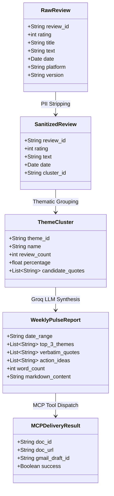

# Architecture Specification: Zomato Customer Review Pulse & MCP Delivery Platform

**System:** AI-Driven Mobile App Review Synthesis & Stakeholder Delivery  
**Product:** Zomato Mobile App (Milestone 2)  
**Derived from:** [`problemstatement.md`](file:///c:/Users/lohith%20k/MCP1/problemstatement.md) · [`Docs/problemstatement.md`](file:///c:/Users/lohith%20k/MCP1/Docs/problemstatement.md)  
**Primary Integration Protocol:** Model Context Protocol (MCP)  
**Primary LLM Inference Provider:** Groq (`llama-3.3-70b-versatile` / `llama-3.1-8b-instant`)

---

## 1. Architectural Goals & Core Invariants

The goal of this system is to transform raw, unstructured mobile app store reviews into an executive, scannable **Weekly Customer Pulse** (≤ 250 words) and publish it directly to stakeholder surfaces (**Google Docs** and **Gmail**) without manual API plumbing or OAuth credential management.

### Architectural Invariants

| # | Invariant | Description |
|---|---|---|
| 1 | **MCP-First Integration** | **Zero direct Google REST API clients.** All document creation and email drafting must be executed via Model Context Protocol (MCP) tool calls over standardized transports (`stdio` or `sse`). |
| 2 | **Filter & Cluster First** | The LLM does not ingest thousands of raw reviews directly. Reviews are pre-filtered, cleaned, and clustered into at most 5 domain themes before LLM synthesis. |
| 3 | **100% Verbatim Quote Veracity** | Quotes selected by the system must be exact substring matches of public review texts in the dataset. Zero invented, modified, or hallucinated quotes. |
| 4 | **Strict Privacy (No PII)** | Customer names, reviewer handles, user IDs, device identifiers, and timestamps must be stripped prior to model synthesis and publishing. |
| 5 | **Strict Word Budget** | The synthesized pulse must remain concise, scannable, and **≤ 250 words** to ensure readability in under 2 minutes. |
| 6 | **Strict Groq Quota & Rate Limits** | Dataset is capped at **1,000 reviews** (scaled down from potential 2,400 raw exports). All LLM invocations against `llama-3.3-70b-versatile` must strictly respect **30 RPM, 1K RPD, 12K TPM, and 100K TPD**. |

---

## 2. High-Level System Architecture

```text
┌────────────────────────────────────────────────────────────────────────────────────────┐
│                               1. INGESTION & PRIVACY LAYER                             │
│   Public App Store / Play Store Exports (8-12 weeks, Capped at 1,000 Reviews)          │
│   ┌────────────────────────────────┐       ┌──────────────────────────────────────┐    │
│   │ Raw Review Ingest (JSON/CSV)   │  ──►  │ PII Sanitizer & Text Normalizer      │    │
│   │ (Capped at 1,000 reviews)      │       │ (English-only, >6 words, No emojis)  │    │
│   └────────────────────────────────┘       └──────────────────────────────────────┘    │
└───────────────────────────────────────────┬────────────────────────────────────────────┘
                                            │ 1,000 Sanitized Reviews
                                            ▼
┌────────────────────────────────────────────────────────────────────────────────────────┐
│                               2. CLUSTERING & ANALYSIS LAYER                           │
│   ┌────────────────────────────────────────────────────────────────────────────────┐   │
│   │ Two-Tier Thematic Clustering Engine (Max 5 Zomato Themes)                      │   │
│   │ • Tier 1: Local Taxonomy Classifier (Python) -> 0 RPM, 0 TPM (1,000 reviews)   │   │
│   │ • Tier 2: Groq Rate-Limited Distillation -> llama-3.3-70b-versatile             │   │
│   │   [Delivery & Riders | Food Quality | Pricing/Fees | App Stability | CS/Refund]│   │
│   │   Enforces Groq Limits: <= 12K TPM, <= 30 RPM, <= 1K RPD, <= 100K TPD          │   │
│   └───────────────────────────────────────┬────────────────────────────────────────┘   │
│                                           │ Top 3 Clusters + Curated Candidate Quotes  │
│                                           ▼                                            │
│   ┌────────────────────────────────────────────────────────────────────────────────┐   │
│   │ Single-Shot Groq Synthesis & Verbatim Verifier (llama-3.3-70b-versatile)       │   │
│   │ (Input: ~750 tokens | Output: ~300 tokens | Total: ~1,050 tokens per run)      │   │
│   │ (Generates Top 3 Themes, 3 Verbatim Quotes, 3 Action Ideas, <= 250 words)      │   │
│   └───────────────────────────────────────┬────────────────────────────────────────┘   │
└───────────────────────────────────────────┬────────────────────────────────────────────┘
                                            │ WeeklyPulseReport DTO
                                            ▼
┌────────────────────────────────────────────────────────────────────────────────────────┐
│                               3. AGENTIC ORCHESTRATION LAYER                           │
│   ┌────────────────────────────────────────────────────────────────────────────────┐   │
│   │ MCP Orchestrator & Client Session Manager                                      │   │
│   │ Discovers tools via JSON-RPC 2.0 (tools/list) and dispatches calls             │   │
│   └───────────────────────────────┬────────────────────────────────┬───────────────┘   │
└───────────────────────────────────┼────────────────────────────────┼───────────────────┘
                                    │ JSON-RPC (stdio)               │ JSON-RPC (stdio)
                                    ▼                                ▼
┌──────────────────────────────────────────────────┐ ┌───────────────────────────────────┐
│              4. GOOGLE DOCS MCP SERVER           │ │          5. GMAIL MCP SERVER      │
│  Tools:                                          │ │  Tools:                           │
│  - create_document(title, content)               │ │  - create_draft(to, subject, body)│
│  - update_document(id, content)                  │ │  - send_draft(draft_id)           │
└─────────────────────────┬────────────────────────┘ └─────────────────┬─────────────────┘
                          │ Internal OAuth Bridge                      │ Internal OAuth
                          ▼                                            ▼
┌──────────────────────────────────────────────────┐ ┌───────────────────────────────────┐
│        Google Docs API (Document Created)        │ │    Gmail API (Draft Created)      │
└──────────────────────────────────────────────────┘ └───────────────────────────────────┘
```

---

## 3. Logical Layers & Components

### 3.1 Data Ingestion & Sanitization Layer

- **`ReviewIngestService`**:
  - Connects to public review dataset exports (e.g. Hugging Face datasets, Google Play / App Store public review CSV/JSON).
  - Filters records to the last **8–12 weeks** of activity, capped at **1,000 reviews**.
  - Normalizes fields to a standard review record:
    ```json
    {
      "review_id": "rev_94821",
      "rating": 1,
      "title": "Delivery was horrible",
      "text": "Food arrived 50 mins late and was cold.",
      "date": "2026-10-14",
      "version": "14.2.0"
    }
    ```
- **`PIISanitizer`**:
  - Drops user names, display names, email addresses, and author profile URLs.
  - Applies regex masks for phone numbers, order IDs, and email strings.
  - Strips all emojis and pictographs.
  - Filters for reviews with $> 6$ words in English language.
  - Guarantees quotes forwarded to the LLM are stripped of user-identifying metadata.

### 3.2 Thematic Clustering Layer (Phase 2) — Rate-Limit Guarded Architecture

To support a scaled corpus of **up to 1,000 reviews** (reduced and sampled from potential 2,400 raw exports) while strictly respecting Groq's free-tier rate limits, Phase 2 implements a **Two-Tier Hybrid Clustering Architecture**:

#### Groq Quota Hard Limits (`llama-3.3-70b-versatile`):
- **Requests Per Minute (RPM):** **30**
- **Requests Per Day (RPD):** **1,000 (1K)**
- **Tokens Per Minute (TPM):** **12,000 (12K)**
- **Tokens Per Day (TPD):** **100,000 (100K)**

#### Why Brute-Force LLM Clustering Fails:
- Passing 1,000 reviews $\times$ ~65 tokens = **~65,000 tokens**. Passing this in a single prompt triggers an immediate **HTTP 429 RateLimitError** (exceeds 12K TPM by $> 5.4\times$).
- 1,000 individual per-review requests exhausts the entire 1,000 RPD daily quota in a single execution.

#### The Two-Tier Clustering Strategy:
1. **Tier 1 — High-Throughput Deterministic Taxonomy Classifier (Python):**
   - Ingests all 1,000 reviews and matches them against the 5 canonical Zomato domain taxonomies using multi-token regex patterns and keyword dictionaries.
   - Computes empirical metrics in **< 50ms**: exact review counts, percentage share, average star rating, and negative review volume.
   - **Groq Cost:** **0 requests (0 RPM), 0 tokens (0 TPM)**.
2. **Tier 2 — Deterministic Severity Scoring & Candidate Quote Mining:**
   - Evaluates the 5 themes using an empirical **Severity Score**:
     $$\text{Severity} = N_{\text{negative}} \times (5.0 - \bar{R})$$
   - Selects the **Top 3 themes** based on real customer pain.
   - Mines a pool of 3–4 high-signal verbatim candidate quotes (15–35 words each) per top theme.
3. **Tier 3 — Groq Distillation & Boundary Resolution (llama-3.3-70b-versatile):**
   - In ambiguous reviews where multi-theme overlap exists or complex boundary disambiguation is desired, reviews are grouped into micro-batches of $\le 10$ reviews ($\le 700$ tokens per call).
   - Rate limiter enforces a pacing delay of $\ge 2.5$ seconds between requests ($\le 24$ RPM $\ll 30$ RPM) and a safety ceiling of $\le 8,000$ TPM ($\ll 12\text{K TPM}$).

### 3.3 LLM Inference Engine & Synthesis Layer (Phase 2 & Phase 3)

- **LLM Provider:** **Groq Cloud LPUs**
  - **Primary Model:** `llama-3.3-70b-versatile`
  - **Fallback Model:** `llama-3.1-8b-instant` (lightweight high-throughput classification)
  - **API Interface:** Groq API / OpenAI-compatible endpoint (`https://api.groq.com/openai/v1/chat/completions`) using `GROQ_API_KEY`.
  - **Per-Run Quota Footprint:**
    - Input Tokens: **~750 tokens** (Top 3 themes metadata + 9 candidate quotes + instructions).
    - Output Tokens: **~300 tokens** (Pulse markdown note $\le 250$ words).
    - **Total Request Tokens:** **~1,050 tokens** (**only 8.7% of 12K TPM limit, 1.05% of 100K daily token limit**).
    - **Total Groq Requests:** **1 single request** (consumes 1 of 30 RPM, leaves 999 requests in daily quota).

- **`PulseSynthesizer`**:
  - Dispatches the compact ~750-token payload to Groq with deterministic settings (`temperature=0.2`, `response_format={"type": "json_object"}`).
  - Enforces output structuring:
    - **Top 3 Themes** (with concise descriptions and percentage weight).
    - **3 Verbatim Quotes** (selected directly from the pre-mined candidates).
    - **3 Action Ideas** (concrete, actionable product/engineering tasks).
- **`VerbatimQuoteVerifier`**:
  - Deterministically verifies each quote against the raw 1,000-review dataset using substring matching.
- **`WordBudgetEnforcer`**:
  - Ensures strict compliance with the **≤ 250 words** constraint.

### 3.4 MCP Orchestrator & Client Layer

- **`MCPClientManager`**:
  - Initiates subprocess connections to registered MCP servers via `stdio` (or HTTP SSE).
  - Performs the standard MCP lifecycle handshake:
    1. `initialize`: Exchanges protocol version and capabilities.
    2. `tools/list`: Discovers available tools from Google Docs and Gmail servers.
    3. `tools/call`: Executes commands with strongly-typed parameter dictionaries.
- **`PublishingWorkflow`**:
  - Step 1: Dispatches `create_document` to the Google Docs MCP server with the formatted pulse.
  - Step 2: Captures the returned `document_id` and public/workspace `document_url`.
  - Step 3: Constructs the email draft containing the pulse text and doc link, and dispatches `create_draft` to the Gmail MCP server.

---

## 4. MCP Server Specifications & Tool Contracts

Instead of direct Google REST API invocations, all interactions use standardized MCP tool schemas.

### 4.1 Google Docs MCP Server

```json
{
  "name": "google_docs_create_document",
  "description": "Creates a new Google Document with formatted markdown or text content.",
  "parameters": {
    "type": "object",
    "properties": {
      "title": {
        "type": "string",
        "description": "Title of the Google Document (e.g., 'Zomato Customer Voice Pulse - W44')"
      },
      "content": {
        "type": "string",
        "description": "Full Markdown/Text content of the weekly pulse note."
      }
    },
    "required": ["title", "content"]
  }
}
```

**Output Payload:**
```json
{
  "document_id": "1abcXYZ-9876543210-PulseDoc",
  "document_url": "https://docs.google.com/document/d/1abcXYZ-9876543210-PulseDoc/edit",
  "status": "success"
}
```

### 4.2 Gmail MCP Server

```json
{
  "name": "gmail_create_draft",
  "description": "Creates an email draft in Gmail with subject, body, and optional direct document link.",
  "parameters": {
    "type": "object",
    "properties": {
      "recipient": {
        "type": "string",
        "description": "Email address of the recipient or alias (e.g., product-team@zomato.internal)"
      },
      "subject": {
        "type": "string",
        "description": "Subject line of the email draft"
      },
      "body": {
        "type": "string",
        "description": "Body content including the weekly pulse and link to Google Doc"
      }
    },
    "required": ["recipient", "subject", "body"]
  }
}
```

**Output Payload:**
```json
{
  "draft_id": "draft_r892348721903",
  "thread_id": "thread_18f92138a0",
  "status": "draft_created"
}
```

---

## 5. End-to-End Sequence Diagram

```mermaid
sequenceDiagram
    autonumber
    actor Stakeholder as User / Stakeholder
    participant Pipeline as Review Ingestion & Analyzer
    participant Verifier as PII & Verbatim Verifier
    participant Groq as Groq LLM (llama-3.3-70b-versatile)
    participant Orchestrator as MCP Client Orchestrator
    participant DocsMCP as Google Docs MCP Server
    participant GmailMCP as Gmail MCP Server

    Stakeholder->>Pipeline: Trigger Weekly Review Pulse Job
    Pipeline->>Pipeline: Fetch 8–12 weeks of store reviews (Capped at 1,000)
    Pipeline->>Verifier: Sanitize reviews & strip PII
    Verifier-->>Pipeline: 1,000 Clean review corpus
    Pipeline->>Pipeline: Cluster into 5 themes; select Top 3
    Pipeline->>Groq: Prompt with Top 3 themes + review snippets (~750 tokens)
    Groq-->>Verifier: Generated pulse (themes, quotes, actions) (~300 tokens)
    Verifier->>Verifier: Check quote verbatim match & word count (<= 250 words)
    Verifier-->>Orchestrator: Verified WeeklyPulseReport DTO

    rect rgb(240, 248, 255)
        Note over Orchestrator,DocsMCP: Google Docs MCP Publishing
        Orchestrator->>DocsMCP: tools/call "google_docs_create_document"
        DocsMCP-->>Orchestrator: { document_id, document_url }
    end

    rect rgb(255, 245, 238)
        Note over Orchestrator,GmailMCP: Gmail MCP Draft Creation
        Orchestrator->>GmailMCP: tools/call "gmail_create_draft" (includes doc link)
        GmailMCP-->>Orchestrator: { draft_id, status: "draft_created" }
    end

    Orchestrator-->>Stakeholder: Execution summary: Google Doc created & Gmail draft ready
```

---

## 6. Data Model & Contracts



---

## 7. Security, Privacy & Error Handling

### 7.1 PII Protection & Data Anonymization
- All raw author names, reviewer identifiers, avatars, user IDs, and contact info are permanently stripped during preprocessing.
- Reviews are processed in memory and never stored in publicly exposed logs with user identifiers.
- Generated quotes represent anonymous feedback snippets only.

### 7.2 MCP Sandboxing & Credential Safety
- Application source code contains **no OAuth tokens, client secrets, or private keys**.
- The MCP server isolates authentication and permissions at the host/environment level.
- The MCP client only interacts with defined tool interfaces (`google_docs_create_document`, `gmail_create_draft`), limiting the blast radius of LLM actions.

### 7.3 Fault Tolerance & Recovery
- **Rate Limit Guard:** Invocations to Groq are protected by token consumption limits and request pacing.
- **Quote Mismatch:** If an LLM hallucination occurs in quote extraction, the `VerbatimQuoteVerifier` triggers a deterministic fallback matching the nearest semantic review row in the cluster.
- **Word Limit Breach:** If word count > 250 words, an automated summarization compression pass reduces prose while preserving the 3 quotes and 3 actions.
- **MCP Connection Timeout:** If an MCP server fails to respond within 15 seconds, exponential backoff retries (max 3 attempts) are executed before surfacing an alert.
