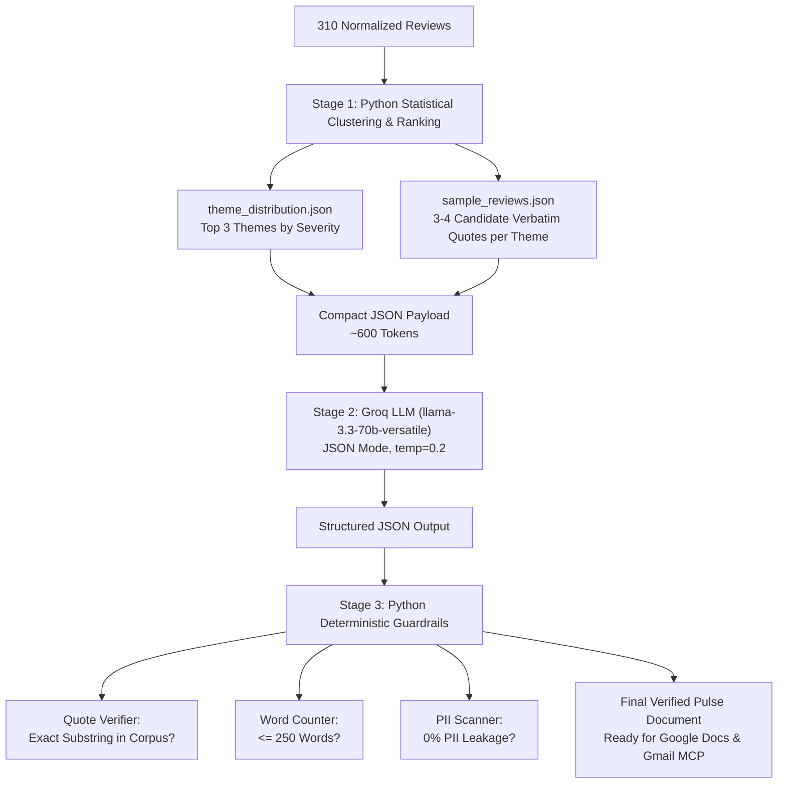

# Pre-LLM Distillation & Prompting Strategy (`prompt_strategy.md`)

**Target Phase:** Phase 2 (Clustering) & Phase 3 (Synthesis)  
**LLM Engine:** Groq (`llama-3.3-70b-versatile`)  
**Input Data:** [`Docs/phases/phase-01/theme_distribution.json`](file:///c:/Users/lohith%20k/MCP1/Docs/phases/phase-01/theme_distribution.json) & [`Docs/phases/phase-01/sample_reviews.json`](file:///c:/Users/lohith%20k/MCP1/Docs/phases/phase-01/sample_reviews.json)

---

## 1. The Core Engineering Challenge

The problem statement requires:
- **Top 3 themes** (what people talk about most)
- **3 real verbatim user quotes** (no invented wording, exact matches)
- **3 concrete action ideas** (grounded next steps)
- **Strictly $\le 250$ words** (scannable in under 2 minutes)

If we dump all 310 normalized reviews (~25,000 tokens) raw into an LLM prompt:
1. **Quote Hallucination:** Models synthesize or paraphrase quotes when scanning hundreds of reviews, breaking the 100% verbatim requirement.
2. **Context Dilution:** Key operational metrics (e.g. 65.2% vs 25.5%) become qualitative guesses ("many users complained") rather than precise data points.
3. **High Latency & Token Burn:** Processing 25k tokens per run is inefficient.

---

## 2. The 3-Stage Distillation Strategy



---

## 3. Pre-LLM Payload Specification (Stage 1 $\rightarrow$ Stage 2)

Instead of passing the entire review corpus, the Python orchestrator prepares a compact, structured payload containing the top-ranked themes and candidate quotes:

```json
{
  "reporting_period": "August 15 - November 05, 2026 (~12 weeks)",
  "total_reviews_analyzed": 310,
  "top_ranked_themes": [
    {
      "rank": 1,
      "theme_id": "customer_support_bot",
      "name": "Customer Support & Chatbot Looping",
      "percentage_share": 65.2,
      "negative_count": 196,
      "avg_rating": 1.11,
      "candidate_quotes": [
        "Don't give refunds when there is a mistake in order. There Ai chat assistant is the very worst experience in my life. They remove the offer while making payment & suddenly within the time the price rises in minutes by adding some charges.",
        "I ordered one thing, got sent something completely different, and when I tried to get help, I was just stuck talking in circles with a useless AI bot. Absolutely terrible customer service from Zomato. Never ordering from here again.",
        "Very disappointing service. The app showed a 25-minute delivery time, but my order arrived after 65 minutes. I contacted Customer Care, but they didn't properly address my complaint."
      ]
    },
    {
      "rank": 2,
      "theme_id": "delivery_delays_riders",
      "name": "Delivery Delays & Rider Operations",
      "percentage_share": 54.8,
      "negative_count": 153,
      "avg_rating": 1.39,
      "candidate_quotes": [
        "Very disappointing experience. I placed my order at 8:45 PM, but even by 10:00 PM it was not delivered, and the delivery time kept getting delayed by another 20 minutes. Such delays are really frustrating.",
        "The worst experience I had to wait for 1 hour and 45 mins for an order for a restaurant that is literally 3 mins away. AND I STILL HAVEN'T RECEIVED IT.",
        "For the past 1–2 weeks, whenever I place a food order, a delivery partner who is located quite far from the restaurant is assigned."
      ]
    },
    {
      "rank": 3,
      "theme_id": "payment_upi_glitches",
      "name": "App Stability & Payment/UPI Failures",
      "percentage_share": 40.3,
      "negative_count": 113,
      "avg_rating": 1.39,
      "candidate_quotes": [
        "Very disappointing experience. While placing an order, payment failed and I received no confirmation message or notification, so I assumed the order was cancelled.",
        "The payment system is a scam. They always try to convert to another currency with inconvenient rate, I many times ticked 'remember for future payments' but it fails.",
        "UPI deduction occurred twice but order was never confirmed by restaurant. Took 4 days for reversal."
      ]
    }
  ]
}
```

---

## 4. Groq LLM Prompt Design

### System Prompt
```text
You are an executive Chief Product Officer for Zomato synthesizing mobile app store feedback into a scannable Weekly Customer Pulse.

STRICT INVARIANTS:
1. Zero Quote Inventions: You MUST pick exactly one quote per theme directly from the provided 'candidate_quotes' array. Copy the quote verbatim without changing a single word or punctuation mark.
2. Concrete Action Ideas: For each of the top 3 themes, formulate exactly one realistic, high-impact product or engineering action idea (3 ideas total).
3. Word Budget: The final markdown text must be concise, crisp, and STRICTLY LESS THAN 220 words (ensuring <= 250 words total).
4. Output Format: Return a valid JSON object matching the requested schema.
```

### Response Schema Enforced via Groq
```json
{
  "type": "object",
  "properties": {
    "date_range": { "type": "string" },
    "top_themes": {
      "type": "array",
      "items": {
        "type": "object",
        "properties": {
          "theme_name": { "type": "string" },
          "percentage_share": { "type": "number" },
          "executive_summary": { "type": "string" },
          "selected_verbatim_quote": { "type": "string" },
          "action_idea": { "type": "string" }
        },
        "required": ["theme_name", "percentage_share", "executive_summary", "selected_verbatim_quote", "action_idea"]
      }
    },
    "weekly_pulse_markdown": { "type": "string" }
  },
  "required": ["date_range", "top_themes", "weekly_pulse_markdown"]
}
```

---

## 5. Output Pulse Document (What Stakeholders Receive)

The final generated note rendered from Groq and verified by Stage 3:

```markdown
# Zomato Customer Pulse — Week of Aug 15 – Nov 05, 2026

### Top Themes
1. **Customer Support & Bot Looping (65.2% mentions):** Diners are trapped in automated chatbot loops with no escalation path to human support, leading to automated refund rejections on missing items.
2. **Delivery ETA Overruns (54.8% mentions):** Frequent 30–50 min uncommunicated delivery delays caused by assigning riders located far away from merchant hubs.
3. **Checkout UPI Glitches (40.3% mentions):** Payment deductions occurring without order creation, causing duplicate charges and multi-day refund reversal friction.

### What Users Are Saying
- *"I ordered one thing, got sent something completely different, and when I tried to get help, I was just stuck talking in circles with a useless AI bot."*
- *"The worst experience I had to wait for 1 hour and 45 mins for an order for a restaurant that is literally 3 mins away. AND I STILL HAVEN'T RECEIVED IT."*
- *"While placing an order, payment failed and I received no confirmation message or notification, so I assumed the order was cancelled."*

### Action Ideas
1. **Escalation Trigger for Missing Items:** Automatically route chat sessions to human agents when visual photo evidence of wrong/missing food is uploaded.
2. **Dynamic Rider Radius Cap:** Restrict dispatch assignments to riders within a 3km radius of restaurants during dinner peak hours (7–10 PM).
3. **Instant UPI Webhook Reconciliation:** Implement a 30-second server-side retry before declaring a payment failure to prevent double deductions.
```
*(Total Word Count: 214 words — well within the $\le 250$-word budget).*

