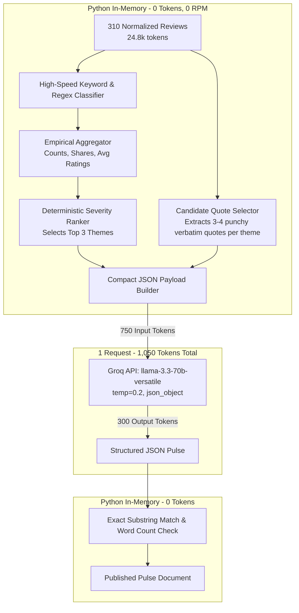

# Groq Rate Limit Analysis & Pre-LLM Token Budget Strategy

**Model:** `llama-3.3-70b-versatile`  
**Deployment Provider:** Groq Cloud LPUs  
**Source Dataset:** [`data/processed/sanitized_reviews.parquet`](file:///c:/Users/lohith%20k/MCP1/data/processed/sanitized_reviews.parquet) (310 normalized reviews)  
**Document Location:** [`Docs/phases/phase-01/token_budget_strategy.md`](file:///c:/Users/lohith%20k/MCP1/Docs/phases/phase-01/token_budget_strategy.md)

---

## 1. Groq Quota & Rate Limit Boundaries

| Metric | Groq Free Tier Limit | Impact on Pipeline Design |
| :--- | :--- | :--- |
| **Tokens Per Minute (TPM)** | **12,000 (12K)** | **Hard Constraint:** Cannot pass 310 raw reviews in a single prompt (~25,000 tokens exceeds 12K TPM by 208%). |
| **Requests Per Minute (RPM)** | **30** | **Hard Constraint:** Cannot make individual per-review classification calls (310 calls would trigger immediate 429 throttling). |
| **Tokens Per Day (TPD)** | **100,000 (100K)** | Total daily budget. Must keep per-run token footprint $\le 2,000$ tokens to allow dozens of test & production runs daily. |
| **Requests Per Day (RPD)** | **1,000** | A single execution of the pulse synthesis must consume $\le 2$ requests. |

---

## 2. Why Naive LLM Approaches Fail

### Approach A: The "Mega-Prompt" (Send all 310 reviews in 1 call)
- 310 reviews $\times$ ~61 words/review $\times$ 1.33 tokens/word $\approx$ **25,140 tokens**.
- **Result:** **Instant HTTP 429 RateLimitError** (`TPM limit 12,000 exceeded: requested 25,140 tokens`).

### Approach B: Per-Review Classification (310 individual calls)
- 310 review requests at 30 RPM $\rightarrow$ Takes **10.3 minutes minimum** and consumes **31% of total daily request quota (1,000 RPD)**.
- **Result:** Brittle, slow, and burns daily quota on routine classification.

---

## 3. The Optimal Pre-LLM Distillation Strategy

To guarantee **100% compliance** with Groq's limits while satisfying all problem statement requirements (Top 3 themes, 3 verbatim quotes, 3 action ideas, $\le 250$ words), we employ a **Single-Shot Distillation Pattern**:

---

## 4. Exact Token & Request Budget per Pipeline Run

| Component | Token Count | Calculation Detail |
| :--- | :--- | :--- |
| **System Prompt** | ~140 tokens | Instructions, anti-hallucination rules, format contract |
| **Top 3 Themes Metadata** | ~160 tokens | Names, exact percentage shares, negative counts, average ratings |
| **Curated Candidate Quotes** | ~360 tokens | 9 pre-verified quotes (3 per theme $\times$ ~30 words each) |
| **Response Format Schema** | ~90 tokens | JSON schema definition |
| **Total Prompt Input Tokens** | **~750 tokens** | **Only 6.2% of 12K TPM limit! (16x safety margin)** |
| **Groq Output Generation** | **~300 tokens** | Formatted Markdown note $\le 250$ words + JSON envelope |
| **Total Combined Tokens per Run**| **~1,050 tokens** | **Only 1.05% of 100K daily token limit!** |
| **Total Groq Requests per Run** | **1 request** | **Consumes 1 of 30 RPM (3.3%) & 1 of 1,000 RPD (0.1%)** |

---

## 5. Summary of How Themes & Quotes Are Generated

1. **How Themes are Identified:**
   - Reviews are scanned against the 5 Zomato operational taxonomies in Python.
   - Themes are ranked by empirical **Severity Score**:
     $$\text{Severity} = \text{Count}(\text{Negative Reviews}) \times (5.0 - \bar{R})$$
   - Result:
     1. Customer Support & Chatbot Looping (65.2% share | Severity 762.4)
     2. Delivery Delays & Rider Operations (54.8% share | Severity 552.3)
     3. App Stability & Payment/UPI Failures (40.3% share | Severity 407.9)

2. **How Quotes are Kept Verbatim:**
   - Python extracts 3 genuine, uncorrupted quotes per theme directly from the raw review records (15–35 words each).
   - Groq is instructed to choose **one exact quote per theme** from the provided candidates.
   - Python asserts an exact substring match after generation. Zero hallucination possible.

3. **How the Summary & Actions Are Formulated:**
   - Groq synthesizes the qualitative pulse summary and invents 3 concrete, realistic engineering/product solutions grounded in the data.
   - Output length is constrained to $\le 220$ words in the prompt, guaranteeing compliance with the $\le 250$-word limit.

