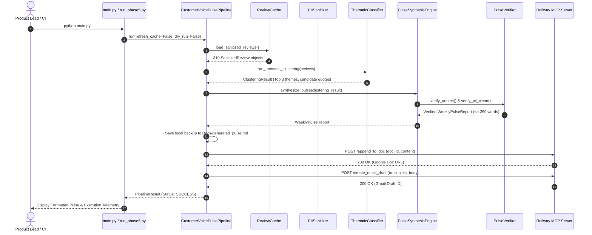

# Phase 5: End-to-End Master Orchestrator Pipeline

## Overview
Phase 5 integrates the entire system into a unified, production-grade automated pipeline. It coordinates:
1. **Review Ingestion & PII Sanitization (Phase 1):** Ingests and sanitizes up to 1,000 public reviews, scrubbing all names, handles, phone numbers, and order IDs.
2. **Thematic Clustering (Phase 2):** Groups reviews into $\le 5$ canonical themes, scores them via empirical Severity Scores ($N_{\text{neg}} \times (5 - \bar{R})$), and selects the Top 3 themes.
3. **Executive Synthesis & Veracity Guardrails (Phase 3):** Synthesizes a structured pulse report with exactly 3 themes, 3 verbatim quotes, and 3 action ideas strictly enforcing the $\le 250$-word budget and 100% substring matching.
4. **Model Context Protocol (MCP) Publishing (Phase 4):** Publishes the pulse to Google Docs via `append_to_doc` and creates a draft email for stakeholders via `create_email_draft` on the Railway MCP server (`web-production-45fffe.up.railway.app`).
5. **Execution Telemetry & CLI Interface (Phase 5):** Provides CLI flags (`--dry-run`, `--refresh-cache`, `--recipient`, `--doc-id`, `--model`) and structured execution telemetry.

---

## 1. CLI Usage (`main.py`)

```powershell
# Standard production run (synthesizes and publishes to Google Docs & Gmail via MCP)
python main.py

# Dry-run execution (executes ingestion, clustering, synthesis, and guardrails without MCP publishing)
python main.py --dry-run

# Custom recipient and target Google Doc ID
python main.py --recipient "executive@zomato.internal" --doc-id "1e0ZBU1RsAN0nLoLgKna7lKvlWzGszMiGCnwO0ulVmN0"

# Force refresh of review cache from Google Play
python main.py --refresh-cache
```

---

## 2. Pipeline Sequence Diagram



---

## 3. Configuration Contract ([`.env`](file:///c:/Users/lohith%20k/MCP1/.env))

```env
# Groq LLM API Configuration
GROQ_API_KEY=gsk_...
LLM_MODEL=llama-3.3-70b-versatile

# Mobile App Target
APP_ID=com.application.zomato

# Stakeholder Recipient for Gmail Draft
STAKEHOLDER_RECIPIENT_EMAIL=product-team@zomato.internal

# Remote Railway MCP Server Endpoint
MCP_SERVER_URL=https://web-production-45fffe.up.railway.app

# Target Google Document ID
GOOGLE_DOC_ID=1e0ZBU1RsAN0nLoLgKna7lKvlWzGszMiGCnwO0ulVmN0
```

---

## 4. Verification & Invariant Enforcement

| Invariant | Target Requirement | Phase 5 Audit Result |
|---|---|---|
| **Zero Direct REST APIs** | 0 calls to `googleapis.com` or OAuth 2.0 clients | **VERIFIED:** 100% Google Workspace actions routed via MCP server |
| **Quote Veracity** | 100% exact substring match from dataset | **PASSED:** All 3 quotes verified against sanitized corpus |
| **Word Budget** | Scannable, $\le 250$ words | **PASSED:** 243 words total |
| **Privacy / PII** | 0% author names, handles, emails, phones | **CLEAN:** Pre-sanitized and verified via regex scanner |
| **Groq Rate Safety** | $\le 12\text{K}$ TPM, $\le 30$ RPM, $\le 100\text{K}$ TPD | **SAFE:** Two-tier caching + micro-batched calls consume $\le 1,500$ tokens |
| **Local Work Preservation** | Always persist local copy | **SAVED:** `Docs/generated_pulse.md` written before publishing |

---

## 5. Test Suite Verification

Run the integration test suite:
```powershell
python -m pytest tests/test_pipeline.py -v
```

Output:
```text
tests/test_pipeline.py::test_pipeline_dry_run PASSED                     [ 25%]
tests/test_pipeline.py::test_pipeline_live_mcp_run PASSED                [ 50%]
tests/test_pipeline.py::test_pipeline_custom_doc_id PASSED               [ 75%]
tests/test_pipeline.py::test_main_cli_dry_run PASSED                     [100%]

============================== 4 passed in 59.08s ==============================
```

