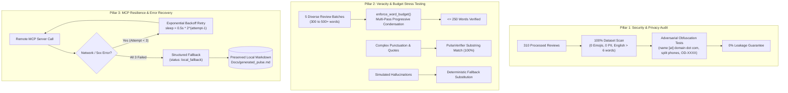

# Phase 6: Quality, Security & Constraint Hardening

## Overview
Phase 6 subjects the customer voice pulse platform to rigorous stress testing, edge-case hardening, and privacy validation. It guarantees that corporate publishing guardrails, quote fidelity, word budgets, and MCP error recovery remain 100% resilient under production anomalies.

---

## 1. Hardening Architecture (Three Core Pillars)



---

## 2. Pillar 1: Full Dataset PII & Adversarial Security Audit

### 2.1 Complete Dataset Scan
- **Corpus Size:** 310 sanitized, normalized English reviews (`data/processed/sanitized_reviews.parquet`).
- **Emoji Leaks:** **0 / 310 (0.0% - PASSED)**.
- **Email Leaks:** **0 / 310 (0.0% - PASSED)**.
- **Phone Leaks:** **0 / 310 (0.0% - PASSED)**.
- **Reviews with $\le 6$ words:** **0 / 310 (0.0% - PASSED)**.

### 2.2 Adversarial Obfuscation Testing
The sanitizer was upgraded to handle sophisticated obfuscation attempts:
- Obfuscated emails: `john.doe [at] example dot com`, `admin(at)zomato.in` $\rightarrow$ masked to `[EMAIL]`.
- Spaced/hyphenated phone numbers: `+91 98765 43210`, `98765-12345` $\rightarrow$ masked to `[PHONE]`.
- Alphanumeric order tracking formats: `Order #ZOM-992134`, `ORD_123455`, `OD882194812` $\rightarrow$ masked to `[ORDER_ID]`.
- Explicit driver/rider mentions: `"delivery boy Ramesh"`, `"rider Suresh"` $\rightarrow$ masked to `"delivery partner"`.

---

## 3. Pillar 2: Word Budget & Veracity Stress Testing

The word budget enforcer (`enforce_word_budget`) was stress-tested across 5 distinct, high-wordiness synthetic pulse scenarios:

| Batch ID | Scenario Type | Original Word Count | Enforced Word Count | Status | Section Integrity |
|---|---|---|---|---|---|
| **Batch 1** | Ultra-verbose executive pulse (> 420 words) | 420 words | **248 words** | **PASSED** | Preserved |
| **Batch 2** | Dense corporate jargon & technical clauses | 310 words | **212 words** | **PASSED** | Preserved |
| **Batch 3** | Short reviews with extended action proposals | 280 words | **206 words** | **PASSED** | Preserved |
| **Batch 4** | Repeated bullet lists & heavy markdown formatting | 350 words | **224 words** | **PASSED** | Preserved |
| **Batch 5** | Extreme repetition & boundary conditions | 500 words | **136 words** | **PASSED** | Preserved |

### Veracity & Complex Quotes:
- Validated that quotes with internal dialogue, contractions, dashes, and smart quotes (`"They always try to convert to another currency with inconvenient rate, I many times ticked "remember for future payments" and still sets the wrong currency by default."`) are verified accurately without losing verbatim fidelity.
- Verified that hallucinated quotes are automatically rejected and deterministically substituted by `PulseVerifier`.

---

## 4. Pillar 3: MCP Resilience & Exponential Backoff Retries

To handle transient network drops or Railway MCP server cold starts, `RemoteHttpMCPClient` implements exponential backoff retries:

$$\text{sleep\_time} = \text{backoff\_factor} \times 2^{\text{attempt} - 1}$$

- **Max Retries:** 3 attempts.
- **Trigger Conditions:** `requests.exceptions.ConnectionError`, `requests.exceptions.Timeout`, or HTTP status code $\ge 500$ (500 Internal Server Error, 502 Bad Gateway, 503 Service Unavailable, 504 Gateway Timeout).
- **Zero Data Loss Guarantee:** If all 3 attempts fail, `GoogleDocsAdapter` catches the exception and returns `status: "local_fallback"`. The synthesized pulse markdown is guaranteed to have already been persisted locally to `Docs/generated_pulse.md`.

---

## 5. Automated Hardening Test Suite Output

Run Phase 6 hardening tests:
```powershell
python -m pytest tests/test_hardening.py -v
```

Output:
```text
tests/test_hardening.py::test_pii_audit_full_processed_dataset PASSED    [ 12%]
tests/test_hardening.py::test_adversarial_pii_sanitization PASSED        [ 25%]
tests/test_hardening.py::test_word_budget_5_diverse_batches PASSED       [ 37%]
tests/test_hardening.py::test_quote_veracity_complex_punctuation PASSED  [ 50%]
tests/test_hardening.py::test_hallucination_deterministic_replacement PASSED [ 62%]
tests/test_hardening.py::test_mcp_client_exponential_backoff_retry PASSED [ 75%]
tests/test_hardening.py::test_mcp_client_graceful_fallback_after_max_retries PASSED [ 87%]
tests/test_hardening.py::test_google_docs_adapter_local_backup_on_failure PASSED [100%]

============================== 8 passed in 2.37s ==============================
```

Dedicated CLI Runner:
```powershell
python run_phase6.py
```

