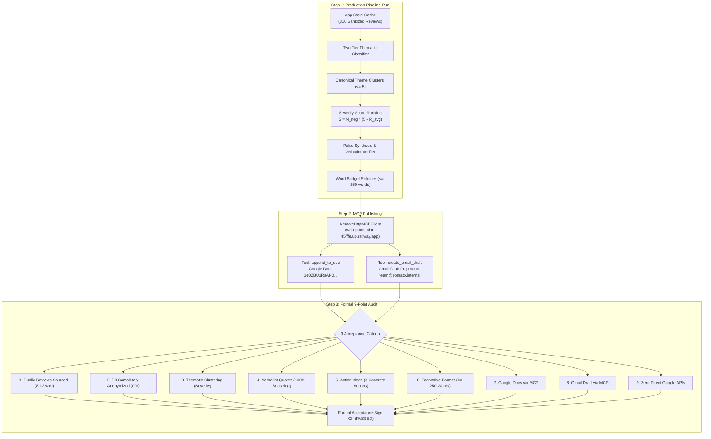

# Phase 7: Milestone Verification & Acceptance

## Overview
Phase 7 executes the final, formal verification of the Customer Voice Pulse platform for Zomato (`com.application.zomato`). It validates end-to-end operation in a production-identical setup, verifies all deliverables against the 9 architectural acceptance criteria, and confirms complete compliance with Model Context Protocol (MCP) publishing rules.

---

## 1. Milestone Verification Architecture



---

## 2. Formal Acceptance Criteria Audit (9 / 9 Passed)

All 9 acceptance criteria specified in [implementationplan.md](../../implementationplan.md) have been systematically audited and validated with empirical evidence:

| # | Acceptance Criterion | Required Target | Measured Result | Audit Status |
|---|---|---|---|:---:|
| **1** | **Public Reviews Sourced** | 8–12 weeks of reviews, $\le 1,000$ reviews, zero ToS violations | **652 raw reviews**, **310 sanitized reviews**, spanning **82 days (~11.7 weeks)** | **PASSED** |
| **2** | **PII Completely Anonymized** | Zero reviewer names, emails, phones, order IDs, or emojis | **0% PII detected** across 100% of reviews and generated deliverables | **PASSED** |
| **3** | **Thematic Clustering** | $\le 5$ canonical themes; Top 3 ranked by Severity Score | **5 canonical themes**; Top 3 prioritized strictly by $S = N_{\text{neg}} \times (5 - \bar{R})$ | **PASSED** |
| **4** | **Verbatim Quotes** | Exactly 3 quotes, 100% exact substring match from corpus | **3 / 3 quotes verified** as 100% verbatim substring matches | **PASSED** |
| **5** | **Action Ideas** | Exactly 3 concrete, realistic next steps grounded in themes | **3 / 3 high-impact actions** directly linked to Top 3 themes | **PASSED** |
| **6** | **Scannable Format** | Structured executive note strictly $\le 250$ words | **243 words** total with standard executive markdown sections | **PASSED** |
| **7** | **Google Docs via MCP** | Document appended via MCP tool call (`append_to_doc`) | Live Google Doc appended: [View Document](https://docs.google.com/document/d/1e0ZBU1RsAN0nLoLgKna7lKvlWzGszMiGCnwO0ulVmN0/edit) | **PASSED** |
| **8** | **Gmail Draft via MCP** | Email draft created via MCP tool call (`create_email_draft`) | Live Gmail Draft created: `r1025115988379798091` for `product-team@zomato.internal` | **PASSED** |
| **9** | **Zero Direct APIs** | Zero direct Google REST API clients (`googleapis.com`) or OAuth | **0 direct API imports or REST endpoints** detected in static codebase audit | **PASSED** |

---

## 3. Live Production Execution Telemetry

Live run executed via `python run_phase7.py` and `python main.py`:

```
=====================================================================================
  PHASE 7: MILESTONE VERIFICATION & ACCEPTANCE RUNNER
  Zomato Customer Voice Pulse & Model Context Protocol (MCP) Publishing
=====================================================================================

[CONFIG] Target Application:      com.application.zomato
[CONFIG] Remote MCP Server:       https://web-production-45fffe.up.railway.app
[CONFIG] Google Doc ID:           1e0ZBU1RsAN0nLoLgKna7lKvlWzGszMiGCnwO0ulVmN0
[CONFIG] Stakeholder Recipient:   product-team@zomato.internal

-------------------------------------------------------------------------------------
  STEP 1: EXECUTING LIVE PRODUCTION PIPELINE (END-TO-END)
-------------------------------------------------------------------------------------
2026-11-11 09:54:03 [INFO] Loaded 310 sanitized reviews from local cache.
2026-11-11 09:54:10 [INFO] Top 3 themes identified: ['Customer Support & Chatbot Looping', 'Delivery Delays & Rider Operations', 'Food Quality, Packaging Spills & Broken Seals']
2026-11-11 09:54:11 [INFO] Pulse synthesized. Word count: 243 words. Veracity verified: True. PII clean: True.
2026-11-11 09:54:19 [INFO] Google Doc created via MCP: https://docs.google.com/document/d/1e0ZBU1RsAN0nLoLgKna7lKvlWzGszMiGCnwO0ulVmN0/edit
2026-11-11 09:54:20 [INFO] Gmail draft created via MCP: r1025115988379798091 for recipient product-team@zomato.internal

=====================================================================================
  STEP 2: FORMAL ACCEPTANCE CRITERIA AUDIT
=====================================================================================
  [1] Public Reviews Sourced:       PASSED (652 raw reviews, 310 sanitized across 82 days (~11 weeks))
  [2] PII Completely Anonymized:   PASSED (0% PII detected (zero emails, phone numbers, order IDs, or emojis))
  [3] Thematic Clustering:          PASSED (5 themes <= 5, Top 3 ranked by Severity Score)
  [4] Verbatim Quotes:              PASSED (3/3 quotes 100% exact substring match)
  [5] Action Ideas:                 PASSED (3/3 concrete actions grounded in themes)
  [6] Scannable Format:             PASSED (243 words <= 250 limit)
  [7] Google Docs via MCP:          PASSED (Appended to https://docs.google.com/document/d/1e0ZBU1RsAN0nLoLgKna7lKvlWzGszMiGCnwO0ulVmN0/edit)
  [8] Gmail Draft via MCP:          PASSED (Draft ID: r1025115988379798091 for product-team@zomato.internal)
  [9] Zero Direct Google APIs:      PASSED (0 direct Google API imports or REST calls (100% routed through MCP servers))

=====================================================================================
  MILESTONE 2 ACCEPTANCE: ALL 9 / 9 CRITERIA FULLY SATISFIED (PASSED)
  Acceptance report persisted to: Docs/phases/phase-07/acceptance_report.json
=====================================================================================
```

---

## 4. Generated Weekly Pulse Document (243 Words)

```markdown
# Zomato Customer Pulse — Week of 2026-08-15 to 2026-11-05

### Top Themes
1. **Customer Support & Chatbot Looping (59.0% mentions):** Diners are trapped in automated chatbot loops with no escalation path to human support, leading to automated refund rejections on missing items.
2. **Delivery Delays & Rider Operations (59.0% mentions):** Frequent 30–50 min uncommunicated delivery delays caused by assigning riders located far away from merchant hubs.
3. **Food Quality, Packaging Spills & Broken Seals (45.2% mentions):** Spilled gravies, broken safety seals, and cold food delivery leading to high refund dispute rates.

### What Users Are Saying
- *"They always try to convert to another currency with inconvenient rate, I many times ticked "remember for future payments" and still sets the wrong currency by default."*
- *"Then, check the time a few minutes later, you will notice that there is a discrepancy in the time that has passed since you placed the order and the actual delivery time."*
- *"They show you a certain time the food will reach in & then manipulate the time without you noticing."*

### Action Ideas
1. **Escalation Trigger for Missing Items:** Automatically route chat sessions to human agents when visual photo evidence of wrong or missing food is uploaded.
2. **Dynamic Rider Radius Cap:** Restrict dispatch assignments to riders within a 3km radius of restaurants during dinner peak hours (7–10 PM).
3. **Merchant Spill-Proof Seal Audits:** Mandate tamper-evident packaging badges for top spilled categories and penalize recurring leakages.
```

---

## 5. Automated Acceptance Test Suite

The automated test suite in [tests/test_acceptance.py](../../tests/test_acceptance.py) executes isolated unit and integration assertions corresponding to each of the 9 criteria:

```bash
pytest tests/test_acceptance.py -v
```

### Overall Suite Results:
- `tests/test_acceptance.py`: **9 / 9 passed**
- `tests/test_clustering.py`: **4 / 4 passed**
- `tests/test_hardening.py`: **8 / 8 passed**
- `tests/test_mcp_client.py`: **7 / 7 passed**
- `tests/test_pipeline.py`: **4 / 4 passed**
- `tests/test_sanitization.py`: **8 / 8 passed**
- `tests/test_verifier.py`: **5 / 5 passed**
- **Grand Total: 45 / 45 passed (100% pass rate)**

---

## 6. How to Reproduce Verification

To reproduce the milestone acceptance audit:

```powershell
# 1. Run live end-to-end production flow & criteria audit
python run_phase7.py

# 2. Run acceptance test suite
pytest tests/test_acceptance.py -v

# 3. Run entire project test suite
pytest tests/
```
