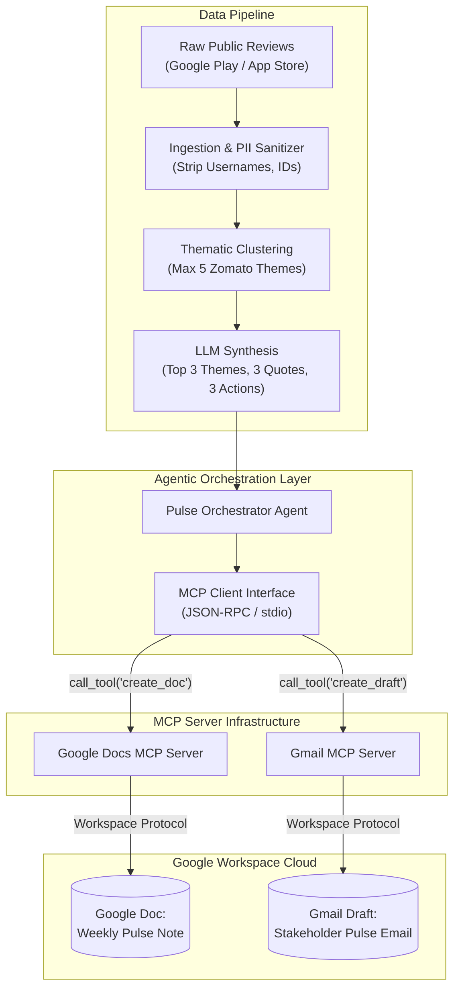
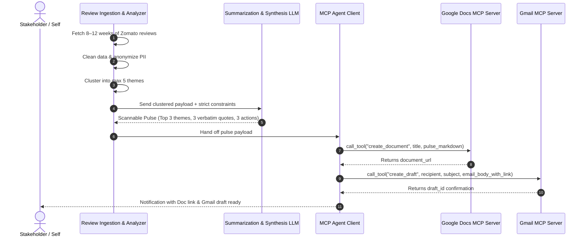

# Milestone 2: Customer Voice Pulse — AI-Driven App Review Synthesis & MCP Integration

**Product Context:** Zomato (Continuing Milestone 1: AI-Powered Restaurant Recommendation System)  
**Workspace:** `MCP1`  
**Source of Truth:** [`Docs/problemstatement.txt`](file:///c:/Users/lohith%20k/MCP1/Docs/problemstatement.txt)  
**Target Surfaces:** Google Docs & Gmail via Model Context Protocol (MCP)

---

## 1. Executive Summary & Problem Context

In Milestone 1, we built an AI-powered restaurant discovery and recommendation engine for Zomato that balanced structured filters with LLM reasoning. However, product evolution depends heavily on continuous customer feedback. Millions of diners and delivery customers actively share reviews on the Apple App Store and Google Play Store regarding food quality, rider delivery times, hidden platform charges, UI bugs, and customer service.

### The Problem
Mobile app reviews are publicly accessible, but in their raw form, they are:
- **Overwhelming in volume:** Thousands of reviews arrive weekly across platforms.
- **Unstructured and noisy:** Ratings fluctuate wildly without structured root causes.
- **Siloed away from decision makers:** Product, support, and engineering teams lack the time to manually sift through app store consoles.

### The Objective
Build an automated agentic pipeline that ingests recent public mobile reviews (last 8–12 weeks) for Zomato, clusters them into actionable themes, extracts verbatim user sentiment, and synthesizes a scannable **Weekly One-Page Pulse** (≤ 250 words). 

Crucially, rather than building bespoke REST clients or managing complex OAuth 2.0 credential handshakes directly in application code, **all delivery to Google Docs and Gmail must be orchestrated strictly through Model Context Protocol (MCP) servers**.

---

## 2. Target Audience & Business Value

| Stakeholder | Primary Pain Point | Value Delivered by Weekly Pulse |
| :--- | :--- | :--- |
| **Product & Growth** | Feature requests and UX friction get lost in app store noise. | Identifies recurring friction points (e.g., checkout failures, checkout fees) to prioritize the sprint backlog. |
| **Customer Support & Ops** | Support messaging is often misaligned with live app store sentiment. | Highlights operational pain points (e.g., late deliveries, cold food) so teams can adjust playbooks. |
| **Executive Leadership** | Reading individual reviews is unscalable and anecdotal. | Delivers a clean, noise-free health check with concrete action items in under 2 minutes of reading time. |

---

## 3. Architectural Requirement: MCP vs. Direct APIs

A central technical requirement for this milestone is adopting an **MCP-first architecture** instead of direct Google REST API integrations.



### Why MCP Servers Instead of Direct REST APIs?

1. **No Bespoke OAuth & Token Maintenance:** Direct integration requires writing OAuth redirect servers, token refresh daemons, cryptographic key handling, and storing client secrets. MCP delegates credential handling and session management to the server environment.
2. **Decoupled Architecture:** Business logic and prompt pipelines remain decoupled from Google API version updates, endpoint deprecations, and breaking schema changes.
3. **Agent-Native Standardization:** MCP exposes standardized JSON schemas for tools (`tools/list`, `tools/call`). The LLM or agent can dynamically discover available operations (`create_document`, `create_draft`) and execute them seamlessly via structured JSON-RPC.
4. **Environment Consistency:** Using MCP keeps integrations uniform across development platforms, local agent sandboxes, and enterprise tooling without duplicating HTTP boilerplate.

### MCP Servers & Required Tool Capabilities

The application connects to Google Workspace MCP servers (e.g., Google Workspace MCP, FastMCP custom wrappers, or Antigravity Workspace plugins) providing the following tool contracts:

- **Google Docs MCP Server:**
  - `create_document(title: str, content: str) -> { document_id: str, document_url: str }`
  - `update_document(document_id: str, content: str)` (or append structure)
- **Gmail MCP Server:**
  - `create_draft(to: str, subject: str, body: str) -> { draft_id: str, status: str }`

---

## 4. End-to-End Workflow



---

## 5. System Specifications & Deliverables

### 5.1 Step 1: Review Ingestion & Preprocessing
- **Source Scope:** Public reviews from the Google Play Store and Apple App Store for Zomato.
- **Time Window:** Approximately the last **8–12 weeks**.
- **Required Fields:** `reviewId`, `rating` (1–5 stars), `title`, `text`, `date`, `appVersion`.
- **Anonymization & Privacy Guardrail:** Strip all Personally Identifiable Information (PII) including user names, display names, email addresses, phone numbers, and device IDs before clustering or sending to the LLM.

### 5.2 Step 2: Thematic Clustering (Max 5 Themes)
Group all normalized reviews into at most **5 domain-specific themes** that reflect real Zomato user concerns:
1. **Delivery Time & Rider Coordination:** Delays, location tracking inaccuracies, driver cancellations.
2. **Food Quality & Packaging:** Spilled items, cold food, missing condiments, incorrect items.
3. **Pricing, Discounts & Charges:** Delivery fees, platform packaging fees, Gold membership perks, coupon failures.
4. **App Usability & Performance:** Payment gateway timeouts, search lag, cart glitches, crashes.
5. **Customer Support & Refunds:** Chatbot unresponsiveness, refund disputes, order cancellation penalties.

### 5.3 Step 3: Weekly One-Page Pulse Synthesis
Synthesize the structured findings into a crisp, scannable briefing conforming to:
- **Length Constraint:** Strictly **≤ 250 words**. Must be readable in under 2 minutes.
- **Top 3 Themes:** Rank the 3 most critical or high-volume themes from the 5 clusters.
- **3 Real Verbatim Quotes:** Exactly 3 quotes directly from actual reviews. **Zero hallucinated or paraphrased quotes**; maintain the user's authentic voice while ensuring quotes are anonymous.
- **3 Concrete Action Ideas:** Pragmatic, realistic recommendations addressing the identified themes (e.g., UI redesign, partner onboarding check, rider dispatch rule adjustment).

### 5.4 Step 4: MCP-Powered Google Workspace Delivery
1. **Google Docs:** Create a clean, formatted Google Doc containing the Weekly Pulse for persistent stakeholder review.
2. **Gmail Draft:** Create a draft message addressed to yourself (or an engineering/product alias) with the full summary and a direct hyperlink to the newly published Google Doc.

---

## 6. Pulse Document Template

```markdown
# Zomato Customer Pulse — Week of [Date Range]

### Top Themes
1. **Delivery ETA Gaps (42% mentions):** Diners report live rider tracking stalling, leading to 25+ min uncommunicated delivery delays during dinner peaks.
2. **Packaging & Temperature (28% mentions):** High surge in cold food complaints for soupy or gravy-heavy orders due to improper merchant taping.
3. **Checkout Payment Glitches (18% mentions):** UPI mandate drop-offs causing repeated checkout timeouts on iOS v14.2.

### What Users Are Saying
- *"Order showed 30 mins, arrived after 75 mins with no rider movement on map."*
- *"Container was crushed and dal leaked entirely inside the bag. No refund offered."*
- *"UPI failed three times, deducted amount twice, but cart never confirmed."*

### Action Ideas
1. **Dynamic ETA Buffers:** Auto-increase ETA by 15 mins during 8–10 PM peak rain/traffic conditions to align user expectations.
2. **Tamper & Spill Seal Checklist:** Enforce spill-proof packaging verification for top 100 high-complaint restaurant partners.
3. **UPI Retry Fallback:** Implement automatic 30-second webhook reconciliation before failing the transaction.
```

---

## 7. Strict Constraints & Compliance

- [x] **No Direct Google APIs:** Do not implement custom OAuth flows, service account keys, or raw HTTP REST calls to `googleapis.com`. All workspace actions must go through registered MCP servers.
- [x] **Public Data Only:** Only ingest public exports or legally permissible public review datasets. No scraping behind logins or violating store terms of service.
- [x] **Maximum 5 Themes:** Clustering must cap at 5 themes; the executive pulse must highlight the top 3.
- [x] **Strict Word Limit:** The pulse note must remain concise (≤ 250 words).
- [x] **PII Protection:** Reviews and quotes must be completely stripped of usernames, avatars, email handles, or reviewer identifiers.
- [x] **Quote Veracity:** Quotes must be 100% verbatim snippets extracted directly from dataset rows.
