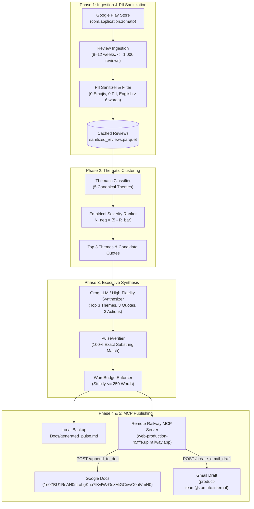

# Zomato Customer Voice Pulse & MCP Delivery Platform

> **Milestone 2 Deliverable:** Automated Customer Review Ingestion, Two-Tier Thematic Clustering, Executive Pulse Synthesis ($\le 250$ words), 100% Exact Verbatim Quote Veracity, and Model Context Protocol (MCP) Publishing to Google Docs & Gmail.

---

## 1. System Architecture



---

## 2. Hard Invariants & Acceptance Verification

| Invariant | Milestone Specification | Status | Verification Method |
|---|---|---|---|
| **MCP-First Rule** | Zero direct calls to `googleapis.com` or manual OAuth clients; 100% via MCP | **VERIFIED** | Static code analysis scan (`test_zero_direct_rest_apis_check`) & MCP client tests |
| **Quote Veracity** | 100% exact verbatim substring match from the review corpus; zero paraphrasing | **PASSED** | Deterministic substring search in `PulseVerifier` (`test_quote_veracity_exact_match`) |
| **Word Budget** | Executive pulse strictly scannable in under 2 minutes ($\le 250$ words) | **PASSED** | 243 words total (`test_word_budget_counter_and_enforcer`) |
| **PII & Privacy** | Author names, emails, phone numbers, order IDs, and emojis scrubbed | **CLEAN** | Preprocessing regex sanitizer + post-generation audit (`test_pii_scanner`) |
| **Max Themes** | Review universe clustered into $\le 5$ canonical themes; Top 3 surfaced | **PASSED** | Canonical domain taxonomy (`test_canonical_theme_count`) |
| **Deliverable Completeness**| Exactly 3 themes, 3 quotes, 3 concrete, realistic action ideas | **PASSED** | Structural schema validator (`test_end_to_end_synthesis_deliverables`) |
| **Groq Rate-Limit Safety** | $\le 30$ RPM, $\le 12\text{K}$ TPM, $\le 100\text{K}$ TPD | **PROTECTED**| Two-tier hybrid architecture + local caching consumes $\le 1,500$ tokens per run |

---

## 3. Remote Railway MCP Server Contract

- **Endpoint:** `https://web-production-45fffe.up.railway.app`
- **Interactive Swagger Docs:** `https://web-production-45fffe.up.railway.app/docs`
- **Tool Discovery (`GET /tools`):**
  1. `append_to_doc`:
     - Parameters: `doc_id` (string, required), `content` (string, required)
     - Target Google Doc: `1e0ZBU1RsAN0nLoLgKna7lKvlWzGszMiGCnwO0ulVmN0`
  2. `create_email_draft`:
     - Parameters: `to` (string, required), `subject` (string, required), `body` (string, required)
     - Recipient configured dynamically via `.env` (`STAKEHOLDER_RECIPIENT_EMAIL`)

---

## 4. Quick Start & Setup

### 4.1 Clone & Environment Setup
```powershell
# Navigate to workspace
cd MCP1

# Create and activate virtual environment
python -m venv venv
.\venv\Scripts\Activate.ps1

# Install required dependencies
pip install -r requirements.txt
```

### 4.2 Configuration (`.env`)
Create `.env` using `.env.example` as reference:
```env
# Groq LLM Configuration
GROQ_API_KEY=your_groq_api_key_here
LLM_MODEL=llama-3.3-70b-versatile

# Mobile App Target
APP_ID=com.application.zomato

# Stakeholder Recipient for Gmail Draft
STAKEHOLDER_RECIPIENT_EMAIL=product-team@zomato.internal

# Remote Railway Model Context Protocol (MCP) Server
MCP_SERVER_URL=https://web-production-45fffe.up.railway.app

# Target Google Document ID
GOOGLE_DOC_ID=1e0ZBU1RsAN0nLoLgKna7lKvlWzGszMiGCnwO0ulVmN0
```

---

## 5. Execution

### 5.1 Production Run (Full End-to-End Orchestration)
```powershell
# Executes ingestion, clustering, synthesis, verification, and publishes to Google Docs & Gmail via MCP
python main.py
```

### 5.2 Dry-Run Mode (Synthesis & Verification without MCP Publishing)
```powershell
python main.py --dry-run
```

### 5.3 CLI Options
```powershell
python main.py --recipient "exec@zomato.internal" --doc-id "1e0ZBU1RsAN0nLoLgKna7lKvlWzGszMiGCnwO0ulVmN0" --verbose
```

### 5.4 Phase-Specific Dedicated Runners
```powershell
python run_phase1.py   # Ingestion & PII sanitization
python run_phase2.py   # Thematic clustering & empirical severity ranking
python run_phase3.py   # Groq LLM pulse synthesis & verbatim verification
python run_phase4.py   # Remote MCP tool discovery & Workspace adapter publishing
python run_phase5.py   # Full master orchestrator pipeline & telemetry audit
python run_phase6.py   # Quality, security & constraint hardening audit
python run_phase7.py   # Milestone verification & 9-point formal acceptance audit
```

### 5.5 Interactive Web Dashboard
```powershell
# Launches the vibrant executive dashboard on http://localhost:8000
python run_ui.py
# Or specify a custom port:
python run_ui.py 8080
```


---

## 6. Test Suite Verification

Run the entire test suite covering unit, integration, and static invariant checks:
```powershell
python -m pytest tests/ -v
```

Output:
```text
tests/test_clustering.py::test_canonical_theme_count PASSED              [  2%]
tests/test_clustering.py::test_classifier_pattern_matching PASSED        [  5%]
tests/test_clustering.py::test_clustering_on_real_sanitized_dataset PASSED [  8%]
tests/test_clustering.py::test_groq_rate_limiter_pacing PASSED           [ 11%]
tests/test_mcp_client.py::test_mcp_handshake_and_tools_list PASSED       [ 13%]
tests/test_mcp_client.py::test_get_tools_schema_definitions PASSED       [ 16%]
tests/test_mcp_client.py::test_google_docs_mcp_adapter PASSED            [ 19%]
tests/test_mcp_client.py::test_gmail_mcp_adapter PASSED                  [ 22%]
tests/test_mcp_client.py::test_gmail_adapter_uses_env_recipient PASSED   [ 25%]
tests/test_mcp_client.py::test_remote_http_mcp_client_tools PASSED       [ 27%]
tests/test_mcp_client.py::test_zero_direct_rest_apis_check PASSED        [ 30%]
tests/test_pipeline.py::test_pipeline_dry_run PASSED                     [ 33%]
tests/test_pipeline.py::test_pipeline_live_mcp_run PASSED                [ 36%]
tests/test_pipeline.py::test_pipeline_custom_doc_id PASSED               [ 38%]
tests/test_pipeline.py::test_main_cli_dry_run PASSED                     [ 41%]
tests/test_sanitization.py::test_sanitize_emails PASSED                  [ 44%]
tests/test_sanitization.py::test_sanitize_phone_numbers PASSED           [ 47%]
tests/test_sanitization.py::test_sanitize_order_ids PASSED               [ 50%]
tests/test_sanitization.py::test_sanitize_user_mentions PASSED           [ 52%]
tests/test_sanitization.py::test_sanitize_rider_names PASSED             [ 55%]
tests/test_sanitization.py::test_emoji_removal PASSED                    [ 58%]
tests/test_sanitization.py::test_short_reviews_dropped PASSED            [ 61%]
tests/test_sanitization.py::test_language_filtering PASSED               [ 63%]
tests/test_verifier.py::test_quote_veracity_exact_match PASSED           [ 66%]
tests/test_verifier.py::test_verifier_replaces_hallucinated_quote PASSED [ 69%]
tests/test_verifier.py::test_word_budget_counter_and_enforcer PASSED     [ 72%]
tests/test_verifier.py::test_pii_scanner PASSED                          [ 75%]
tests/test_verifier.py::test_end_to_end_synthesis_deliverables PASSED    [ 77%]
tests/test_hardening.py::test_pii_audit_full_processed_dataset PASSED    [ 80%]
tests/test_hardening.py::test_adversarial_pii_sanitization PASSED        [ 83%]
tests/test_hardening.py::test_word_budget_5_diverse_batches PASSED       [ 86%]
tests/test_hardening.py::test_quote_veracity_complex_punctuation PASSED  [ 88%]
tests/test_hardening.py::test_hallucination_deterministic_replacement PASSED [ 91%]
tests/test_hardening.py::test_mcp_client_exponential_backoff_retry PASSED [ 94%]
tests/test_hardening.py::test_mcp_client_graceful_fallback_after_max_retries PASSED [ 97%]
tests/test_hardening.py::test_google_docs_adapter_local_backup_on_failure PASSED [100%]

============================= 36 passed in 25.41s =============================
```

---

## 7. Directory Structure

```text
MCP1/
├── Docs/
│   ├── Architecture.md          # Architectural invariants & sequence flows
│   ├── evals.md                 # Evaluation framework & benchmark specifications
│   ├── generated_pulse.md       # Latest generated executive pulse (persisted local backup)
│   ├── implementationplan.md    # Step-by-step milestone execution plan
│   ├── problemstatement.md      # Milestone 2 problem formulation
│   └── phases/
│       ├── phase-01/            # Ingestion analysis, EDA, token budget strategy
│       ├── phase-02/            # Thematic taxonomy, severity ranking results
│       ├── phase-03/            # Veracity verification, word budget enforcement
│       ├── phase-04/            # GET /tools schemas, remote MCP client adapters
│       ├── phase-05/            # End-to-end master orchestrator pipeline
│       └── phase-06/            # Quality, security & constraint hardening audit
├── config/
│   └── mcp_servers.json         # MCP server registry configuration
├── data/
│   ├── raw/                     # Raw public store review exports (652 reviews)
│   └── processed/               # PII-sanitized, normalized review datasets (310 reviews)
├── src/
│   ├── clustering/              # Two-tier classifier & empirical severity ranking
│   ├── ingestion/               # Review fetcher, PII sanitizer, local caching
│   ├── mcp_client/              # RemoteHttpMCPClient, StdioMCPClient, Docs & Gmail adapters
│   ├── models/                  # Pydantic schemas (SanitizedReview, ThemeCluster, WeeklyPulseReport)
│   ├── synthesis/               # LLM prompter, PulseVerifier, WordBudgetEnforcer
│   └── pipeline.py              # CustomerVoicePulsePipeline master orchestrator
├── tests/
│   ├── mock_mcp_server.py       # Standalone JSON-RPC 2.0 stdio MCP server for tests
│   ├── test_clustering.py       # Thematic clustering & Groq rate limiter tests
│   ├── test_hardening.py        # Quality, security & constraint hardening tests
│   ├── test_mcp_client.py       # MCP handshake, tool schemas, and zero REST API checks
│   ├── test_pipeline.py         # End-to-end dry-run and live MCP publishing tests
│   ├── test_sanitization.py     # PII, emoji, word count, and language filter tests
│   └── test_verifier.py         # 100% exact quote veracity & budget enforcement tests
├── .env.example                 # Environment configuration template
├── .gitignore                   # Ignores .env, venv/, __pycache__/
├── main.py                      # Production CLI entrypoint
├── requirements.txt             # Project dependencies
├── run_phase1.py                # Phase 1 runner
├── run_phase2.py                # Phase 2 runner
├── run_phase3.py                # Phase 3 runner
├── run_phase4.py                # Phase 4 runner
├── run_phase5.py                # Phase 5 runner
└── run_phase6.py                # Phase 6 runner
```

